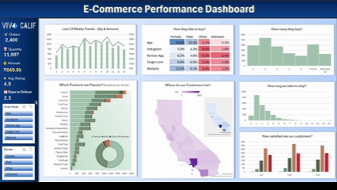
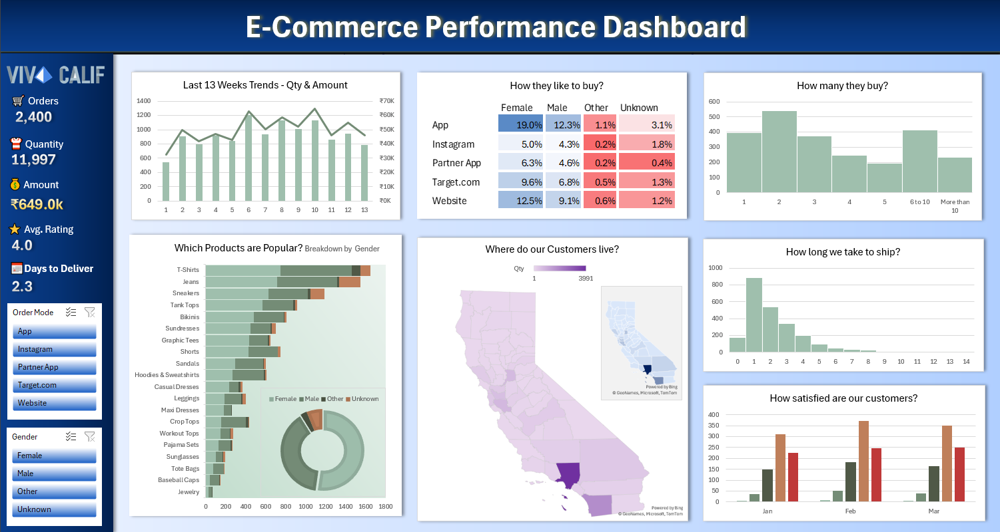

# E-Commerce Sales & Logistics Dashboard

## Project Overview
An interactive Excel dashboard designed to analyze e-commerce performance across sales trends, customer demographics, and shipping logistics. This project transforms raw transaction data into actionable business insights to help stakeholders optimize logistics timelines, identify channel-specific growth opportunities, and track performance targets.

  

---

## 📊 Analytical Framework

### Core Key Performance Indicators (KPIs) Tracked
* **Total Orders**: Total volume of customer transactions processed.
* **Total Quantity**: Cumulative volume of physical items sold.
* **Total Amount**: Gross revenue breakdown generated across all platforms.
* **Avg. Rating**: Aggregated metric evaluating baseline customer satisfaction.
* **Avg. Days to Deliver**: Key operational pipeline timeline metric tracking fulfillment efficiency.

https://github.com/user-attachments/assets/13bca340-537b-47f9-96eb-a001de1e3a1a

### Business Questions Addressed
1. **Trend in the last 13 weeks**: How is our volume shifting over a rolling fiscal quarter?
2. **How our customers like to buy**: Which acquisition platforms (App, Website, Instagram) yield the highest conversions?
3. **How many they buy?**: What is the typical distribution frequency of item counts per transaction order?
4. **Which products are popular?**: What is the volume performance breakdown of specific apparel items categorized by gender?
5. **Overall gender split**: What are the broader macro demographic trends across our user base?
6. **Where do our customers live?**: What does our geographical density map look like for regional distribution strategies?
7. **How long we take to ship the orders**: What does our absolute logistical operational turnaround look like day-by-day?
8. **How happy are our customers?**: Are customer satisfaction tiers trending positively over consecutive months?

---

## 💡 Key Business Insights & Strategic Recommendations
* **Sales Dynamics**: Evaluated quantities and total revenue across a rolling 13-week period to identify order volume peaks, allowing supply chain teams to balance inventory.
* **Customer Acquisition**: Uncovered that the **App** and **Instagram** platforms are highly effective at capturing the female demographic, pointing to optimal channels for targeted marketing spends.
* **Logistics & Fulfillment**: Analyzed order processing intervals to discover critical delivery delays occurring between days 2 and 4, identifying an opportunity to streamline warehouse transit procedures.

---

## 🛠️ Technical Excel Competencies Demonstrated
* **Advanced Data Modeling**: Implemented relational mapping between primary sales transactions, global geography keys, and shipping tracking fields.
* **Complex Formula Design**: Leveraged analytical functions including `XLOOKUP`, `INDEX/MATCH` matrix structures, and logical nested `IF` chains for clean extract-transform-load (ETL) processing.
* **UI/UX Engineering**: Structured interactive dashboards utilizing synchronized cross-filtering slicers, localized map chart visualizations, and locked sheet structure controls to prevent end-user formatting breaks.
* **Pivot Integration Layer**: Constructed isolated data aggregation matrices to dynamically update front-end visualizations without introducing processing latency.

